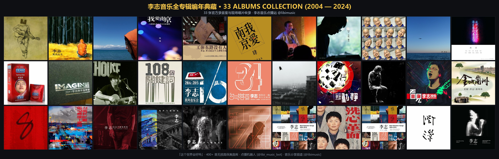

# 🎸 李志完整音乐编年史与数字曲库档案
# Li Zhi Complete Discography & Music Archive (2004–2024)

[](https://drive.google.com/drive/folders/11hqbITTyJLbfVLr9_Oxy2lQAFn0d-ruG?usp=sharing)
[](#-33-张唱片编年史与权威分类全貌)
[](#-双轨歌词与音频元数据工程规范)
[](#-李志-20-年创作大数据词频报告-nlp-analysis)
[](https://t.me/libimusic)
[](https://t.me/libi_music_bot)

> **“妈妈，这个世界会好吗？”**  
> 本项目是一项由独立音乐乐迷发起并维护的**民间抢救性数字文化归档工程**。全面系统考证音乐人**李志（Li Zhi）**自 2004 年至 2024 年 20 年间的全部音乐出版物与现场录音。收录全部 **33 张唱片、490 首曲目**，彻底完成 **全格式无损音轨内嵌真实纯净歌词** 与 **独立同名 UTF-8 `.lrc` 同级双轨配对**，为离线收藏、车载中控、Hi-Fi 播放器及移动端提供最权威、最纯净、最完整的数字典藏底本。

<p align="center">
  
</p>

---

## 💎 曲库核心工程成果与特色

区别于网络各处零散流通、注音混乱、版本残缺的音源，本项目历经长达数周的系统化考证与工程化清洗：

* 💿 **33 张全本收录，零错漏孤儿**：严格对照维基百科与官方实体唱片年表，划分「经典录音室创作全集（9张）」、「官方现场Live全本（14张）」、「海外限定精选（3张）」与「巡演专场与珍稀小样（7张）」。
* 📝 **双轨纯净歌词工程（Dual-Track Lyrics）**：
  * **内嵌歌词（Embedded Tags）**：490 首曲目全部完成元数据内嵌（FLAC Vorbis `LYRICS`、MP3/WAV ID3v2 `USLT`、M4A `©lyr`），手机与流媒体软件开箱即显。
  * **独立同名 `.lrc` 文件（Sidecar LRC）**：全曲目 1:1 配对生成同名 UTF-8 编码 `.lrc` 文本文件，同级存放，专为**特斯拉/新能源汽车车载中控**、**海贝/飞傲 Hi-Fi 无损播放器**及传统车载播放系统量身定制。
* 🧼 **100% 真实纯净文本，彻底剔除注音乱码**：市面流传版本充斥拼音注音残余（如 `nǐ hǎo zhèng zhōu`）与 OCR 错字，本项目全部校对还原为李志原版标点与文学文本。
* 🖼️ **全套高清封面与年份元数据规范**：每张唱片均附带官方高清封面图，规范统一艺术家、年份、专辑标签与曲目编号。
* 📊 **深度 NLP 大数据图景**：运用自然语言处理技术对全量歌词分词提取，凝练李志 20 年创作的精神图景与地名地理版图。

---

## ☁️ 曲库获取与收听方式

| 获取途径 | 访问方式 | 适合场景与说明 |
| :--- | :--- | :--- |
| 🌐 **谷歌云端硬盘<br>(Google Drive)** | [👉 访问 33 盘全曲库无损下载](https://drive.google.com/drive/folders/11hqbITTyJLbfVLr9_Oxy2lQAFn0d-ruG?usp=sharing) | **【最推荐收藏渠道】** **12.4 GB** 完整打包，包含 33 个规范文件夹、490 首高保真音频、490 个同名 `.lrc` 歌词与高清唱片大图。即下即用，支持转存个人网盘。 |
| 📻 **Telegram 音乐频道** | [👉 @libimusic](https://t.me/libimusic) | **【移动端随时收听】** 按 2004–2024 年代顺序列队推送，完整保留音频标签与封面，支持 Telegram 内置播放器后台播放、锁屏操控与离线缓存。 |
| 🤖 **Telegram 随身点播助手** | [👉 @libi_music_bot](https://t.me/libi_music_bot) | **【曲库随身交互助手】** 支持中文/拼音模糊搜歌（如 `fgxs` 搜《梵高先生》）、5大场景电台、每日歌词日签与曲库词频大数据报告。 |
| 📮 **曲库纠错与交流** | [guojinglod@gmail.com](mailto:guojinglod@gmail.com) | 若在聆听过程中发现音质瑕疵、标签错误或珍稀版本线索，欢迎来信交流。 |

---

## 📚 33 张唱片编年史与权威分类全貌

曲库按李志音乐生涯 5 大创作阶段与发行性质组织目录（共 33 盘 / 490 首曲目 / 1,054 个文件）：

```text
Z:\音乐\李志\ (12.4 GB / 33 张专辑 / 490 首歌曲)
├── 01. 经典录音室创作全集 (Studio Albums · 9张)
│   ├── [2004] 被禁忌的游戏            (9首，青春期残酷独白，含《黑色信封》《被禁忌的游戏》)
│   ├── [2005] 梵高先生                (8首，南京绝唱与孤独巅峰，含《梵高先生》《董卓瑶》)
│   ├── [2006] 这个世界会好吗          (10首，时代困惑之问，含《这个世界会好吗》《海的女儿》)
│   ├── [2009] 我爱南京                (双碟21首，人文南京史诗，含《天空之城》《郑州》《苍井空》)
│   ├── [2010] 你好，郑州              (10首，质朴民谣归真，含《关于郑州的记忆》《定西》)
│   ├── [2011] F                      (9首，摇滚编曲新探索，含《山阴路的夏天》《下雨》)
│   ├── [2014] 1701                   (8首，乐队美学巅峰，金曲奖入围作，含《热河》《热河》)
│   ├── [2016] 8                      (9首，纯真童谣全新翻作)
│   └── [2016] 在每一条伤心的应天大街上 (8首，数字销量奇迹，含《一胀一落》《应天大街》)
├── 02. 官方现场与交响乐全本 (Official Live Albums · 14张)
│   ├── [2009] 二零零九年十月十六日事件  (Livehouse 早期狂暴现场)
│   ├── [2010] 工体东路没有人          (北京愚公移山极简不插电现场)
│   ├── [2011] 我们也爱南京            (南京江南剧院跨年音乐会)
│   ├── [2012] Imagine Live           (摇滚大编制高能跨年现场)
│   ├── [2013] 勾三搭四                (上海浅水湾 Livehouse 两天专场)
│   ├── [2013] 108个关键词             (南京不插电跨年音乐会)
│   ├── [2015] I／O                    (工人体育馆大体量制作跨年现场)
│   ├── [2015] 动静 (2015 Live)        (乐队与电声碰撞现场)
│   ├── [2015] 看见 (李志2015巡演)     (全国顶级场馆巡演现场录音)
│   ├── [2016] 李志北京不插电现场       (十三月唱片高品质声学不插电)
│   ├── [2017] 李志、电声与管弦乐       (跨界史诗，交响乐团联合编配)
│   ├── [2018] 爵士乐与不插电新编12首  (经典名曲爵士与室内乐变奏)
│   ├── [2018] 李志、电声与管弦乐II    (交响管弦二度升华，大编制恢宏现场)
│   └── [2024] 叁缺壹 (2024 Tokyo Live) (东京现场最新录音，海外绝响)
├── 03. 日本限定官方精选辑 (Best Selection - 日本波丽佳音 · 3张)
│   ├── [2019] Best Selection Songs 2004-2018 Vol.1 舶来品 (海外高保真再版)
│   ├── [2019] Best Selection Songs 2004-2018 Vol.2 现象   (经典名曲海外母带重制)
│   └── [2020] 装蒜 (Live Best Selection 2004-2018 Vol.3)  (跨年与现场高光合集)
├── 04. 巡演专场与跨年实况录音 (Tours & Bootleg · 5张)
│   ├── [2009] 义乌隔壁酒吧            (动物凶猛巡演收官战，绝版醉酒独唱《梵高先生》)
│   ├── [2012] 杭州酒球会一身酒气      (江南专场生猛实况)
│   ├── [2014] “挺”不插电巡演 郑州站    (中原不插电深情现场)
│   ├── [2015] 金城兰州                (翻唱低苦艾《兰州兰州》现场实况)
│   └── [2019] 洗心革面 跨年音乐会     (欧拉艺术空间封箱跨年演出)
└── 05. 乐迷合辑与早期珍稀小样 (Compilations & Demos · 2张)
    ├── 杂选 (散落网络单曲、早期Demo小样与影视插曲)
    └── 李志LIVE精选 (历年巡演念白与高光碎片集锦)
```

---

## 🏷️ 双轨歌词与音频元数据工程规范

曲库执行严格的音频工程归档标准，保障全设备开箱即用的优质收听体验：

```text
曲目文件结构示范：
📁 01. 经典录音室专辑/04. 我爱南京 (2009)/
   ├── 01. 天空之城.flac        <-- 内嵌 Vorbis Comments 纯净歌词 + 高清专辑封面
   ├── 01. 天空之城.lrc         <-- 独立同名 UTF-8 编码 LRC 歌词（供车载/Hi-Fi设备）
   ├── 02. 倒影.flac
   ├── 02. 倒影.lrc
   └── cover.jpg               <-- 1:1 正方形高保真唱片封面大图
```

### 1. 元数据内嵌技术标准
* **FLAC 格式**：写入 Vorbis Comments 标准帧 `TITLE`、`ARTIST`、`ALBUM`、`DATE`、`TRACKNUMBER`，内嵌 `LYRICS` 与 `UNSYNCEDLYRICS`。
* **MP3 / WAV 格式**：写入 ID3v2.3 规范帧，歌词写入 `USLT` 帧（Encoding: UTF-8，Language: `chi`）。
* **M4A / AAC 格式**：写入 MP4 atom 标准，歌词写入 `©lyr` 标签。

### 2. 车载中控与无损播放器同名 LRC 规范
* 针对大部分新能源车机（特斯拉、蔚来、理想、小鹏等）、传统车载 USB 播放系统以及硬件无损播放器（飞傲、海贝、索尼）无法读取内嵌多行标签的痛点，为 **490 首曲目全部配对生成同名 `.lrc` 文件**。
* 纯音乐与乐器独奏曲（共 32 首）统一规范标注为 `[纯音乐，请欣赏]`，避免设备显示空歌词。

---

## 📊 李志 20 年创作大数据词频报告 (NLP Analysis)

基于本项目深度清洗的 490 首曲目真实纯净歌词库，借助 Jieba NLP 分词与词频向量模型分析，凝练李志 20 年音乐创作的核心精神图景：

### 🏆 全局高频核心词 Top 15
| 排名 | 核心词汇 | 出现频次 | 象征寓意与代表作品 |
| :---: | :---: | :---: | :--- |
| **01** | **世界** | 54 次 | “妈妈，这个世界会好吗？”、“世界是怎样的世界” |
| **02** | **生活** | 48 次 | “爱情不过是生活的屁”、“奔跑在生活的大街上” |
| **03** | **天空** | 47 次 | “飞机飞过天空，天空之城” |
| **04** | **心慌** | 41 次 | “有人在哭泣，有人在心慌” —— 时代群体的精神浮躁与焦虑 |
| **05** | **妹妹** | 32 次 | “港岛妹妹，你献给我的西班牙馅饼” —— 青春伤逝的永恒意象 |
| **06** | **孤独** | 31 次 | “我们生来就是孤独，我们生来就是孤单” |
| **07** | **沉默** | 31 次 | “在沉默中死亡，在死亡中歌唱” |
| **08** | **爱情** | 27 次 | “关于爱情，我们了解的太少” |
| **09** | **城市** | 25 次 | 异乡漂泊与钢筋水泥的疏离感 |
| **10** | **奔跑** | 25 次 | “我们依然要奔跑在生活的大街上” |
| **11** | **自由** | 17 次 | “有人在白昼里寻找自由” |
| **12** | **姑娘** | 13 次 | 倾诉与对话的拟人化投影 |
| **13** | **离开** | 12 次 | 流浪、告别与漂泊的宿命隐喻 |
| **14** | **啤酒/酒** | 11 次 | “没有人在意你在这里喝过的啤酒” |
| **15** | **悲伤** | 10 次 | “所有的悲伤都是因为过去” |

### 🌆 核心地理版图与城市印记
* **南京 / 热河 / 山阴路 / 应天大街** (38次) —— 精神故乡与现实归宿（《山阴路的夏天》、《热河》）
* **郑州** (8次) —— 青春记忆与告别之城（《关于郑州的记忆》）
* **兰州 / 金城** (7次) —— 大西北的苍茫与孤寂（《金城兰州》）
* **港岛 / 西班牙** (27次) —— 遥远而幻灭的理想彼岸（《山阴路的夏天》）

> 完整分词图表与词云详报请参阅：[`docs/lyrics_nlp_report.md`](docs/lyrics_nlp_report.md)

---

## 🎧 配套点播助手：Telegram 随身机器人

为了方便乐迷无需下载 12.4GB 全量文件即可随时点播聆听，本项目同步开源了配套的 Telegram 随身点播机器人（[@libi_music_bot](https://t.me/libi_music_bot)）与同步频道（[@libimusic](https://t.me/libimusic)）：

* 🔍 **拼音智能搜索**：自研加权算法，输入 `fgxs` 秒出《梵高先生》，输入 `zz` 命中《关于郑州的记忆》，输入 `tkzc` 秒播《天空之城》。
* ⚡ **全局行内点播（Inline Query）**：在任意聊天框输入 `@libi_music_bot ` 即可唤出随缘好歌，一键以音频卡片形式分享给好友。
* 📻 **心境场景电台**：设有深夜 Emo、现场摇滚、极简民谣、管弦跨界、城市漫游 5 大主题，内置防重复推荐去重机制。
* 📜 **每日歌词日签**：精选 30 句经典歌词日签，支持直接一键播放出处单曲。
* 🛡️ **轻量免维护部署**：支持 NanoPi R2S / OpenWrt 软路由、VPS 与 Docker 容器一键常驻运行。

---

## 📁 项目归档目录结构

```text
├── music.db                   # 490 首曲目与 Telegram 消息映射权威数据库
├── batch_embed_lyrics.py      # 本地音频歌词批量内嵌与同名 LRC 生成工具
├── requirements.txt           # Python 依赖项列表
├── docs/                      # 深度研究文档
│   └── lyrics_nlp_report.md   # 李志歌词自然语言处理 (NLP) 词频分析详报
├── scripts/                   # 历史采集、海报渲染与维护脚本
│   ├── generate_cover_banner.py # 33 专辑封面拼接海报生成引擎
│   └── analyze_lyrics.py      # 歌词分词与大数据统计脚本
├── bot/                       # Telegram 配套点播机器人源码与配置
│   ├── assets/                # 静态视觉素材 (33 张专辑全家福编年海报)
│   ├── bot.py                 # 机器人主服务 (handlers/分类/电台/日签/搜索)
│   ├── database.py            # SQLite 数据模型 (拼音索引/加权打分/冷启动随机)
│   ├── mood_quotes.py         # 场景电台关键词/30句日签库/NLP大数据摘要
│   ├── lyrics_bank.py         # 内置纯净经典歌词库 (88KB)
│   ├── config.py              # 统一环境变量加载与自适应路径探测
│   ├── deploy_r2s.py          # NanoPi R2S 软路由一键自动化运维工具
│   ├── Dockerfile             # 容器化运行配置
│   └── docker-compose.yml     # Docker 编排配置
└── README.md                  # 🌟 李志完整音乐编年史与数字曲库主页
```

---

## 🤝 项目致谢与心声 (Acknowledgments)

本项目发起人（[@dddyang](https://github.com/dddyang)，邮箱：[guojinglod@gmail.com](mailto:guojinglod@gmail.com)）是一位热爱独立音乐的普通乐迷。

面对 33 张唱片、490 首曲目的庞大数字整理工程：
* 从**维基百科年表考证与 33 张专辑目录规范重组**；
* 到**490 首音轨全格式纯净歌词清洗与批量内嵌**；
* 到**专为车载中控与 Hi-Fi 播放器研发的同名 UTF-8 `.lrc` 双轨配对生成**；
* 到**NLP 自然语言分词大数据图景提取**；
* 到**配套随身点播机器人与云端全量打包归档**；

全程由 **Google DeepMind 的 Antigravity 智能体 (AI Assistant)** 作为深度结对编程伙伴，协同完成全栈数据工程与代码落地。

> “这个世界会好吗？”——谨以此项目致敬独立音乐的精神力量，致敬人类乐迷的热爱与前沿人工智能的数字化赋能！

---

## 🔒 免责声明

1. **文化抢救与非盈利性质**：本项目设立初衷为民间乐迷对独立音乐作品的**数字遗产抢救、编年史考证与非盈利文化归档**。
2. **版权声明**：本项目代码与整理工具遵循 MIT 许可协议。项目本身**不包含任何商业盈利目的，不托管收费服务**。
3. **音源使用建议**：下载资源仅供个人文化学习与音质研究使用，请支持正版音乐与原创独立音乐人。
