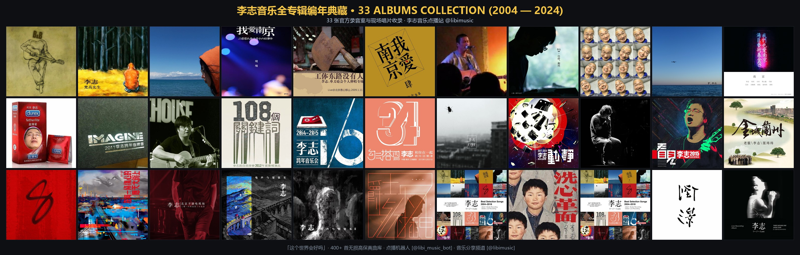

# 🎸 李志全系音乐唱片编年史与超清影音数字典藏
# Li Zhi Complete Discography & Ultra-HD Video Archive (2004–2025)

[](https://drive.google.com/drive/folders/11hqbITTyJLbfVLr9_Oxy2lQAFn0d-ruG?usp=sharing)
[](#-35-张唱片编年史与权威分类全貌)
[](#-双轨纯净歌词与音频工程)
[](#-74-部全系高清原画影音数字典藏全库)
[](https://t.me/libimusic)
[](https://t.me/libi_music_bot)

> **“妈妈，这个世界会好吗？”**  
> 本项目是一项由独立极客与音乐乐迷发起的**抢救性民间数字文化遗产归档工程**。系统性考证并完整收录音乐人**李志（Li Zhi / 逼哥）**自 2004 年至 2025 年 20 余年间的全部音乐出版物与珍贵影像资料。  
> 包含 **35 张官方发行与现场唱片（529 首母带级全无损曲目）** 与 **74 部超清原画现场演出现场/纪录片全集**，彻底终结市面散碎版本音质劣化、拼音乱码、封面残缺与视频断流等顽疾，构建最权威、最纯粹、最完整的数字典藏底本。

<p align="center">
  
</p>

---

## ⚡ 核心典藏规模与工程特性

区别于网络零散流通、注音混乱、画质残缺的二次压缩音源，本项目采用全栈工程化管道完成系统考证与清洗归档：

* 💿 **35 张编年唱片全本，529 首母带无损零错漏**：严格考据官方实体唱片年表，划分「经典录音室全集（9张）」、「官方现场Live全本（16张）」与「海外限定精选/巡演合辑（10张）」。
* 🎬 **74 部全量高清原画影音大典**：涵盖 2007~2019 历年全场跨年、2025 叁缺壹吉隆坡万人演唱会全场、叁叁肆巡演官方各省纪录片、逼哥夜话全集与绝版现场单曲。
* 📝 **双轨纯净歌词工程（Dual-Track Lyrics）**：
  * **内嵌无损标签**：529 首曲目全部嵌入规范标签（FLAC Vorbis `LYRICS`、MP3/WAV ID3v2 `USLT`、M4A `©lyr`），播放器开箱即显。
  * **外挂独立同名 `.lrc`**：1:1 配对生成同名 UTF-8 编码歌词，专为新能源车机（特斯拉等）、Hi-Fi 播放器量身定制。
  * **100% 真实纯净文本**：彻底清洗网抓版本中的拼音注音（如 `nǐ hǎo zhèng zhōu`），还原原汁原味的文学词句。
* 🤖 **极简 Telegram 随身点播助手**：
  * 🎲 **随缘一曲**：随机盲盒，联动李志经典哲思语录卡片与即刻秒播。
  * 🔍 **秒级精准检索**：支持歌名、拼音缩写（如 `fgxs`、`zz`、`tkzc`、`跨年`）与逆向歌词搜索。
  * 🎧 **专辑沉浸连播**：一键直达频道对应唱片时间线，调用 Telegram 原生播放内核顺序连播整张专辑。
  * 🛡️ **群组轻量守护**：在交流群中仅作为入群乐迷常识答题验证员，平时静默隐身，绝不刷屏打扰。

---

## ☁️ 曲库与影音获取通道

| 获取途径 | 访问入口 | 适合场景与说明 |
| :--- | :--- | :--- |
| 🌐 **谷歌云端硬盘<br>(Google Drive)** | [👉 访问全量曲库与影音归档](https://drive.google.com/drive/folders/11hqbITTyJLbfVLr9_Oxy2lQAFn0d-ruG?usp=sharing) | **【永久收藏与本地归档】** 完整打包分级目录、母带无损音轨、同名 `.lrc` 歌词与超清大文件原画视频，支持一键转存个人云盘。 |
| 📻 **Telegram 音乐频道** | [👉 1701 音乐馆 (@libimusic)](https://t.me/libimusic) | **【原生免下载随身推流】** 2004–2025 编年推流，置顶分类双索引导航，支持 Telegram 原生后台息屏听歌与车机蓝牙连播。 |
| 💬 **Telegram 乐迷群组** | [👉 1701 讨论室](https://t.me/libimusic) | **【乐迷记忆交流社区】** 纯净无打扰的乐迷精神据点，绑定频道每首作品留言讨论，分享现场故事与听歌感受。 |
| 🤖 **Telegram 随身点播助手** | [👉 @libi_music_bot](https://t.me/libi_music_bot) | **【随身私聊交互中枢】** 私聊直搜歌曲、盲盒抽歌、多版本现场横向切换；在任意聊天框键入 `@{bot_username} 歌名` 即可发送卡片。 |

---

## 📚 35 张唱片编年史与权威分类全貌

全曲库按李志创作生涯与发行性质规范重构（共 35 盘 / 529 首曲目）：

```text
├── 01. 经典录音室创作全集 (Studio Albums · 9张)
│   ├── [2004] 被禁忌的游戏            (9首，青春期残酷独白，含《黑色信封》《被禁忌的游戏》)
│   ├── [2005] 梵高先生                (8首，南京绝唱与孤独巅峰，含《梵高先生》《董卓瑶》)
│   ├── [2006] 这个世界会好吗          (10首，时代困惑之问，含《这个世界会好吗》《海的女儿》)
│   ├── [2009] 我爱南京                (双碟21首，人文南京史诗，含《天空之城》《关于郑州的记忆》)
│   ├── [2010] 你好，郑州              (10首，质朴民谣归真，含《墙上的向日葵》《定西》)
│   ├── [2011] F                      (9首，摇滚编曲探索，含《山阴路的夏天》《下雨》)
│   ├── [2014] 1701                   (8首，乐队美学巅峰，金曲奖入围作，含《热河》《大象》)
│   ├── [2016] 8                      (9首，纯真童谣全新重编)
│   └── [2016] 在每一条伤心的应天大街上 (8首，数字销量纪录，含《一胀一落》《应天大街》)
├── 02. 官方现场演出与交响全本 (Official Live Albums · 16张)
│   ├── [2009] 二零零九年十月十六日事件  (早期狂暴 Livehouse 摇滚现场)
│   ├── [2010] 工体东路没有人          (北京愚公移山极简声学现场全本)
│   ├── [2011] 我们也爱南京            (南京江南剧院跨年音乐会实况)
│   ├── [2012] Imagine Live           (大编制摇滚高能跨年现场)
│   ├── [2013] 勾三搭四                (上海浅水湾 Livehouse 两日专场录音)
│   ├── [2013] 108个关键词             (南京不插电跨年音乐会全本)
│   ├── [2015] I／O                    (工人体育馆万人制作跨年实况)
│   ├── [2015] 动静 (2015 Live)        (乐队与电声剧烈碰撞现场)
│   ├── [2015] 看见 (李志2015巡回演唱会)(全国大型场馆巡演现场录音)
│   ├── [2016] 李志北京不插电现场 2016  (十三月唱片高水准原声不插电)
│   ├── [2017] 李志、电声与管弦乐       (跨界史诗，管弦乐团联合编配)
│   ├── [2018] 爵士乐与不插电新编12首  (经典名曲爵士与室内乐变奏)
│   ├── [2018] 李志、电声与管弦乐II    (交响管弦二度升华，大编制恢宏现场)
│   ├── [2024] 叁缺壹 (2024 Tokyo Live) (东京现场最新录音，海外重聚)
│   ├── [2025] 2025 叁缺壹 吉隆坡现场全场实况 (吉隆坡万人演唱会全场音频全本)
│   └── [2025] 2025 叁缺壹 吉隆坡站    (吉隆坡精选9首高保真版)
└── 03. 海外限定精选、巡演专场与珍稀录音 (Tours & Compilations · 10张)
    ├── [2019] Best Selection Songs 2004-2019 (Vol.1) 舶来品 (日本波丽佳音限定出版)
    ├── [2020] Best Selection Songs 2004-2018 (Vol.2) 现象   (海外母带重制再版)
    ├── [2020] Best Selection Songs 2004-2018 (Vol.3) 装蒜   (Live精选海外重刻版)
    ├── [2009] 义乌隔壁酒吧            (动物凶猛巡演收官战，绝版醉酒独唱《梵高先生》)
    ├── [2012] 杭州酒球会一身酒气      (江南专场生猛现场实录)
    ├── [2014] “挺”不插电巡演 郑州站    (中原不插电深情现场)
    ├── [2015] 金城兰州                (翻唱低苦艾《兰州兰州》现场提取)
    ├── [2019] 洗心革面 跨年音乐会     (欧拉艺术空间封箱跨年演出)
    ├── 杂选                           (散落网络单曲、早期Demo小样与影视插曲)
    └── 李志LIVE精选                   (历年巡演念白与高光碎片集锦)
```

---

## 🎬 74 部全系高清原画影音数字典藏全库

```text
74 部超清原画影音架构一览：
├── 🎪 历年跨年与演唱会现场 (21部完整全场)
│   ├── [2007] 将进酒·北京星光现场
│   ├── [2009] 我爱南京演唱会 / 工体东路没有人 (节选)
│   ├── [2010] 去没有去过的地方跨年音乐会
│   ├── [2011] IMAGINE 跨年音乐会
│   ├── [2012] 波士顿演唱会 / 108个关键词跨年
│   ├── [2013] 杀鸡取卵·长沙站
│   ├── [2014] iO 跨年音乐会
│   ├── [2015] 看见·全国巡演北京站 / 一身酒气·杭州酒球会
│   ├── [2016] 降噪·摇滚民谣系列 / 简单生活节现场
│   ├── [2017] 电声与管弦乐Ⅰ / 简单生活节现场
│   ├── [2018] 电声与管弦乐Ⅱ / 爵士乐与不插电新编
│   ├── [2019] 洗心革面跨年音乐会 (欧拉封箱全场，上下半场完整版)
│   └── [2025] 叁缺壹吉隆坡演唱会 (全场完整版 / 2.61GB 无缝连贯原画)
├── 🚗 叁叁肆巡演官方纪录片 (26部各省全本)
│   ├── 云南站：01 ~ 06 (含荒篇)
│   ├── 安徽站：官方预告 + 01 ~ 05
│   ├── 山东站：01 ~ 06
│   ├── 陕西站：01 ~ 07
│   └── 特辑篇：叁叁肆计划 00 发布会实况
├── 🎙️ 逼哥夜话与深度对谈 (14部深度漫谈)
│   ├── 第1季 (8部)：香港 / 重庆 / 贵阳 / 昆明(上/下) / 宁波 / 厦门 / 上海
│   └── 第2季 (6部)：上海 / 北京 / 武汉 / 深圳 / 西安 / 重庆
├── 📽️ 精选专访与珍贵纪录片 (9部)
│   ├── 深度纪实：焚碟实录 / iO制作特辑 / 相信未来筹备 / 成都三缺一纪实 / 吉隆坡幕后 / 生存实验
│   └── 名家专访：凤凰网非常道 / 我是一颗荔枝 / 腾讯网音乐后现场
└── 🎸 经典现场单曲高清珍藏 (4部)
    ├── 和你在一起 (吉他+口琴版 / 勾三搭四跨年版)
    ├── 最后一枪 (星光现场高清实况)
    └── 梵高先生 (义乌隔壁酒吧绝版醉酒独唱实录)
```

---

## 🛠️ 项目轻量工程结构

```text
├── music.db                   # 529 首曲目 + 74 部影音元数据 SQLite 数据库
├── requirements.txt           # 核心依赖项 (aiogram 3.x, pypinyin 等)
├── bot/                       # Telegram 配套点播与守门机器人系统源码
│   ├── assets/                # 视觉素材与欢迎横幅
│   ├── handlers/              # 模块化路由器 (音乐点播/原画影音/智能搜索/群组验证)
│   │   ├── common.py          # /start 核心主控与搜索指南
│   │   ├── music.py           # 专辑编年史、切歌控制台与多版本切换
│   │   ├── video.py           # 74 部原画视频分类流式推流
│   │   ├── verify.py          # 1701 讨论室乐迷常识入群验证守门员
│   │   └── search_inline.py   # 全局拼音/歌名加权搜索与 Inline Query
│   ├── ui/                    # 原生交互卡片与对称内联键盘工厂
│   ├── bot.py                 # 异步主入口 (长轮询/自动重连/权限生命周期管理)
│   ├── database.py            # SQLite 数据模型 (拼音索引/加权分词/版本关联)
│   ├── lyrics_bank.py         # 经典歌词纯净核心库
│   └── config.py              # 配置自适应探测
└── README.md                  # 🌟 项目终极权威曲库文档
```

---

## 🤝 声明与心声 (Acknowledgments)

本项目由独立音乐乐迷（[@dddyang](https://github.com/dddyang)，邮箱：[guojinglod@gmail.com](mailto:guojinglod@gmail.com)）主导。

在完成 35 张唱片、529 首无损曲目与 74 部原画大片的抢救性数字归档过程中：
* 严格考据实体唱片编年史与重组规范目录；
* 批量清洗并内嵌 529 首音轨标签与车载同名 UTF-8 `.lrc` 双轨歌词；
* 重构 74 部超清原画现场影像与官方纪录片；
* 架构常驻轻量 Linux 节点的异步点播与守门机器人服务；

全程由 **Google DeepMind 的 Antigravity 智能体 (AI Assistant)** 作为全栈结对编程伙伴协同攻坚完成。

> **“这个世界会好吗？”** —— 谨以此项目致敬独立音乐的精神力量，致敬人类乐迷的热爱与极客前沿人工智能的数字化赋能！

---

## 🔒 免责声明

1. **文化抢救与非盈利性质**：本项目设立初衷为民间乐迷对独立音乐作品的**数字文化遗产抢救、编年史考据与非商业文化归档**。
2. **开源许可**：本项目代码与整理工具遵循 MIT 许可协议。项目本身**不包含任何商业盈利目的，不托管任何收费服务**。
3. **音源使用建议**：下载资源仅供个人文化学习与音质研究使用，请尊重原创音乐人及版权所有方合法权益。
